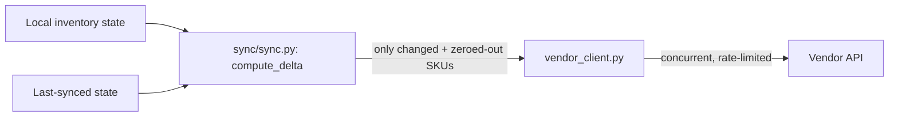

🟡 Portfolio demo, runnable locally, not deployed

# inventory-sync-demo

Push-direction sync: diff local inventory against what was last pushed, send only what changed, and zero out (never silently drop) items that disappeared. One piece of a small multi-service platform demo, see [Related repos](#related-repos) for the rest.

This is a sanitized, generic rebuild for portfolio purposes. No real vendor, client, or company data is used anywhere in this repo. More context: [paulocremas-showcase](https://github.com/paulocremas-showcase). Full portfolio: [paulocremas.github.io](https://paulocremas.github.io). Built to the standard defined in my [Constitution](https://github.com/paulocremas/paulocremas-method).

## Table of contents
- [What this is](#what-this-is)
- [Flow](#flow)
- [Running it](#running-it)
- [Design notes](#design-notes)
- [Rules](#rules)
- [Related repos](#related-repos)

## What this is

The other two repos in this set pull data in. This one pushes it out: take a local view of inventory, compare it against what the vendor was last told, and send only the difference. The interesting problem isn't the HTTP call, it's the diff: unchanged stock shouldn't cost an API call, and a delisted item shouldn't just vanish from the sync and leave stale, sellable stock sitting on the vendor's side.

## Flow



1. [sync/sync.py](sync/sync.py)'s `compute_delta()` is the whole idea: changed quantities, brand-new SKUs, and zeroes for SKUs that were synced before but aren't in the local state anymore.
2. [sync/vendor_client.py](sync/vendor_client.py) pushes the delta concurrently, bounded by a semaphore, same rate-limiting shape as the read-side clients in the sibling repos.
3. [sync/demo.py](sync/demo.py) runs one cycle against an in-memory mock vendor and prints exactly what got pushed.

## Running it

```
python3 -m venv .venv && source .venv/bin/activate
pip install -r requirements.txt

python -m sync.demo
```

Smoke tests: `python tests/test_sync.py`

## Design notes

- **Idempotent by construction.** An unchanged SKU produces zero API calls. This matters more than it sounds: a naive "push everything every run" sync burns rate limit on no-ops and makes it impossible to tell a real update from noise in the vendor's own logs.
- **Delisted means zero, not deleted.** Dropping a SKU from the local state has to actively zero it out on the vendor side, not just stop mentioning it, otherwise the last known quantity stays live and sellable somewhere it shouldn't be.
- **Push concurrency is bounded the same way pull concurrency is** in [data-etl-demo](https://github.com/paulocremas-showcase/data-etl-demo): a semaphore, not an unbounded `gather`, because the vendor's rate limit doesn't care which direction the traffic is going.

Full reasoning and the decision this codifies: [ADR-0001](docs/adr/0001-delisted-skus-sync-as-explicit-zero.md).

## Rules

- `compute_delta` must never include a SKU whose value didn't change.
- A SKU missing from local state must produce an explicit zero, never a silent no-op.
- No real vendor, client, or company names or data anywhere in this repo.

## Related repos

- [data-extraction-demo](https://github.com/paulocremas-showcase/data-extraction-demo) — the pull direction, sequential
- [data-etl-demo](https://github.com/paulocremas-showcase/data-etl-demo) — the pull direction, concurrent
- [ai-enrichment-demo](https://github.com/paulocremas-showcase/ai-enrichment-demo) — enriches records after they land
- [ops-dashboard-demo](https://github.com/paulocremas-showcase/ops-dashboard-demo) — monitors all of the above for schedule collisions
